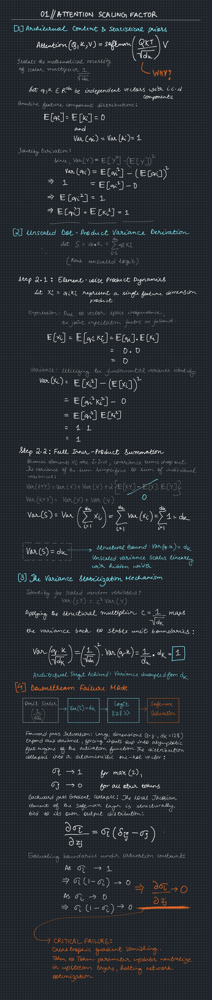

# Module 01 // Attention Scaling Factor: Variance Proof & System Analysis

---

## Overview

The scaled dot-product attention mechanism sits at the computational heart of every Transformer architecture in production today. Its definition is deceptively simple:

$$
\text{Attention}(Q, K, V) = \text{softmax}\!\left(\frac{QK^\top}{\sqrt{d_k}}\right) V
$$

The $\sqrt{d_k}$ denominator is one of the most consequential single tokens in modern deep learning, a scalar correction that stabilizes training across all model scales. Yet it is routinely treated as a given, an engineering heuristic smuggled in without justification.

This module derives the necessity of that factor from axioms, confirms the derivation empirically via PyTorch simulation, and traces the precise hardware-level failure cascade that unfolds when it is omitted.

---

## Part I: First-Principles Variance Derivation

### 1.1 Setup and Assumptions

Let $q, k \in \mathbb{R}^{d_k}$ be query and key vectors whose components are drawn independently from a standard normal distribution:

$$
q_i, k_i \overset{i.i.d.}{\sim} \mathcal{N}(0, 1)
\quad \forall\, i \in \{1, \ldots, d_k\}
$$

This yields the following moment conditions which we will invoke throughout:

$$
\mathbb{E}[q_i] = \mathbb{E}[k_i] = 0
\qquad
\text{Var}(q_i) = \text{Var}(k_i) = 1
\implies
\mathbb{E}[q_i^2] = 1
$$

The raw dot-product (the unnormalized attention logit) is:

$$
S = q^\top k = \sum_{i=1}^{d_k} q_i k_i
$$

Our target is to characterize $\text{Var}(S)$ exactly.

---

### 1.2 Element-Wise Product Dynamics

Define the random variable $X_i = q_i k_i$ for each dimension $i$. Since $q_i$ and $k_i$ are independent:

**Mean:**

$$
\mathbb{E}[X_i] = \mathbb{E}[q_i k_i] = \mathbb{E}[q_i]\,\mathbb{E}[k_i] = 0 \cdot 0 = 0
$$

**Second moment:** Since $q_i$ and $k_i$ are independent standard normals, and $\mathbb{E}[q_i^2] = \mathbb{E}[k_i^2] = 1$:

$$
\mathbb{E}[X_i^2] = \mathbb{E}[q_i^2 k_i^2] = \mathbb{E}[q_i^2]\,\mathbb{E}[k_i^2] = 1 \cdot 1 = 1
$$

**Variance:**

$$
\text{Var}(X_i) = \mathbb{E}[X_i^2] - \left(\mathbb{E}[X_i]\right)^2 = 1 - 0 = 1
$$

Each element-wise product contributes exactly one unit of variance.

---

### 1.3 Full Dot-Product Summation

The dot-product $S = \sum_{i=1}^{d_k} X_i$ is a sum of $d_k$ terms. Since the components $q_i$ are mutually independent and the components $k_i$ are mutually independent, the cross terms $X_i = q_i k_i$ are pairwise uncorrelated:

$$
\text{Cov}(X_i, X_j) = \mathbb{E}[X_i X_j] - \mathbb{E}[X_i]\,\mathbb{E}[X_j] = 0
\quad \text{for } i \neq j
$$

Applying the variance-of-a-sum rule for uncorrelated variables:

$$
\boxed{
\text{Var}(S) = \text{Var}\!\left(\sum_{i=1}^{d_k} X_i\right) = \sum_{i=1}^{d_k} \text{Var}(X_i) = d_k \cdot 1 = d_k
}
$$

The variance of the raw attention logit grows **linearly** with the key dimensionality. For $d_k = 128$ (the head dimension used by Nemotron 3 Ultra 550B, Arcee Trinity Large 398B, and K-EXAONE 236B), the standard deviation of the raw logit is $\sqrt{128} \approx 11.3$, a spread large enough to compress the softmax distribution toward a hard one-hot.

---

### 1.4 The Scaling Correction

Define the scaled logit $\tilde{S} = \frac{1}{\sqrt{d_k}} S$. By the scaling law for variance:

$$
\text{Var}(\tilde{S}) = \text{Var}\!\left(\frac{1}{\sqrt{d_k}} S\right) = \left(\frac{1}{\sqrt{d_k}}\right)^2 \cdot \text{Var}(S) = \frac{1}{d_k} \cdot d_k
$$

$$
\boxed{
\text{Var}\!\left(\frac{S}{\sqrt{d_k}}\right) = 1
}
$$

The scaling factor $1/\sqrt{d_k}$ is the **unique** constant that restores the variance to the unit interval regardless of model dimension. It is not a hyperparameter; it is the mathematically determined correction for the variance amplification introduced by the inner product.

---

## Part II: System Failure Analysis - Softmax Saturation and Vanishing Gradients

### 2.1 Softmax Saturation

The softmax function over a logit vector $z \in \mathbb{R}^n$ is:

$$
\sigma_i(z) = \frac{e^{z_i}}{\sum_{j=1}^{n} e^{z_j}}
$$

When the unscaled dot-products $S \sim \mathcal{N}(0, d_k)$ are fed directly into softmax, the inputs arrive with standard deviation $\sqrt{d_k}$. As $d_k$ grows, the logit magnitudes push into the **asymptotic tails** of the exponential: one logit dominates the numerator exponentially while all others decay toward zero. The output distribution collapses toward a degenerate one-hot vector:

$$
\text{For } z_i \gg z_j\ (j \neq i): \quad \sigma_i \to 1, \quad \sigma_j \to 0
$$

This is softmax **saturation**: the distribution loses entropy and the attention pattern becomes maximally peaked. The model can only attend to a single token with near-certainty, collapsing the multi-head attention mechanism to a selection operation.

---

### 2.2 Vanishing Gradients Through the Jacobian

The Jacobian of the softmax with respect to its inputs characterizes how gradients flow backward through the attention weights. Its elements are:

$$
\frac{\partial \sigma_i}{\partial z_j} = \sigma_i \left(\delta_{ij} - \sigma_j\right)
$$

where $\delta_{ij}$ is the Kronecker delta. Consider what happens in the saturated regime where $\sigma_p \to 1$ for some peak index $p$ and $\sigma_j \to 0$ for all $j \neq p$:

**On-diagonal terms** ($i = j = p$): The gradient at the peak dimension is:
$$
\frac{\partial \sigma_p}{\partial z_p} = \sigma_p(1 - \sigma_p) \to 1 \cdot (1 - 1) = 0
$$

**Off-diagonal terms** ($i = p,\ j \neq p$): Gradients flowing to non-peak logits:
$$
\frac{\partial \sigma_p}{\partial z_j} = -\sigma_p \sigma_j \to -1 \cdot 0 = 0
$$

**Non-peak diagonal terms** ($i = j \neq p$): Gradients at dominated positions:
$$
\frac{\partial \sigma_i}{\partial z_i} = \sigma_i(1 - \sigma_i) \to 0 \cdot 1 = 0
$$

The **entire Jacobian collapses to zero** in the saturated regime. The gradient magnitude $\left\|\frac{\partial \mathcal{L}}{\partial z}\right\|$ is bounded above by the spectral norm of this Jacobian, which is approaching zero as the inputs grow large.

---

### 2.3 The Hardware Failure Cascade

The system-level consequence is a complete stall of the parameter update mechanism:

1. **Forward pass: variance expansion.** For $d_k = 128$ (e.g. Nemotron 3 Ultra 550B), unscaled logits arrive at softmax with $\sigma \approx 11.3$. The exponential maps these to numbers on the order of $e^{11} \approx 5.9 \times 10^{4}$ for dominant entries, pushing floating-point arithmetic toward overflow on GPU tensor cores, and driving all non-dominant entries to the FP16 underflow floor ($\approx 6 \times 10^{-8}$).

2. **Softmax output: entropy collapse.** The output probability vector is numerically indistinguishable from a Dirac delta. All attention weight is concentrated on a single key token per query. The $d_v$-dimensional value aggregation $\sum_j \alpha_j V_j$ degenerates to a single row selection; the weighted average is no longer a weighted average.

3. **Backward pass: dead attention weights.** The vanishing Jacobian ensures that the gradient of the loss with respect to the pre-softmax logits $\frac{\partial \mathcal{L}}{\partial z}$ is essentially zero. By the chain rule, this propagates backward to zero out gradients for $W_Q$ and $W_K$, the weight matrices responsible for computing queries and keys.

4. **Optimizer neutralization.** With near-zero gradients flowing through the attention logit computation, the Adam/AdamW parameter updates for $W_Q$ and $W_K$ reduce to:
$$
\Delta W \approx \eta \cdot \frac{\hat{m}}{\sqrt{\hat{v}} + \epsilon} \approx 0
$$
   The first and second moment estimates $\hat{m}$ and $\hat{v}$ converge to zero, and the weight matrices cease updating. On a multi-GPU training run, every device in the attention parameter group enters a **gradient desert**; the model's capacity to learn token-to-token relationships is entirely disabled while all other parameter groups continue updating, creating systematic representation misalignment that compounds across layers and training steps.

5. **Recovery impossibility.** Because the saturation is self-reinforcing (large weights produce large logits, which produce larger saturation), the network cannot self-recover from this failure mode through gradient descent alone. The $\sqrt{d_k}$ correction must be structurally embedded in the forward pass computation graph.

---

## Summary

| Property | Unscaled $S = q^\top k$ | Scaled $\tilde{S} = S / \sqrt{d_k}$ |
|----------|------------------------|--------------------------------------|
| $\mathbb{E}[\cdot]$ | $0$ | $0$ |
| $\text{Var}(\cdot)$ | $d_k$ | $1$ |
| Softmax behavior | Saturated, peaked | Smooth, distributed |
| Jacobian magnitude | $\to 0$ | $\mathcal{O}(1)$ |
| Gradient flow | Vanishing | Healthy |
| Training outcome | Parameter stall | Stable convergence |

The scaling factor $1/\sqrt{d_k}$ is not a design choice; it is the closed-form solution to the variance normalization problem imposed by the geometry of inner products in high-dimensional space.

---

*Module 01: first-principles-ai*
